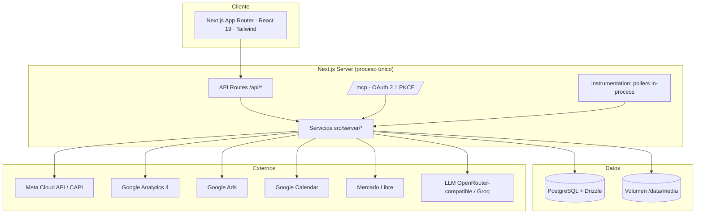
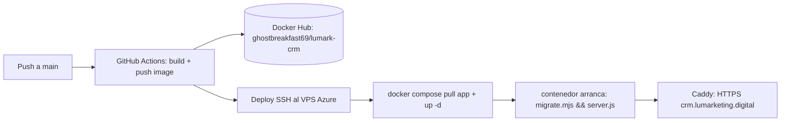

# Arquitectura actualizada — Zorro Tech

> Descripción de la arquitectura **real** verificada en el repositorio (commit base `5ce91e2`).
> No describe una arquitectura hipotética: cada capa corresponde a código existente.

## Vista general

- **Monolito Next.js 15** (App Router) con lógica de negocio en `src/server/*` y UI en `src/app/(app)/*`.
- **Tiempo real por SSE** (`/api/events`), sin WebSockets ni colas externas; el trabajo en segundo
  plano (agente, pollers) es in-process (`src/instrumentation.ts`).
- **Multi-tenancy**: `organization_id` en toda tabla de dominio; las consultas pasan por `scoped()`
  (`src/lib/db/tenant.ts`).
- **MCP**: `/mcp` con OAuth 2.1 + PKCE S256 (`src/server/mcp/oauth.ts`, `src/app/oauth/*`,
  `src/app/.well-known/*`) — recién añadido, con lectura y escritura tras `MCP_WRITE_ENABLED`.

## Módulos de dominio (`src/server/`)

| Módulo | Rol | Estado |
|---|---|---|
| `contacts`, `inbox`, `whatsapp`, `instagram`, `messenger`, `zernio` | CRM conversacional multicanal | Implementado |
| `leads`, `pipeline` | Oportunidades y etapas | Implementado (1 lead/contacto) |
| `quotes`, `catalog` | Cotizador y catálogo | Implementado (sin vínculo a proyecto) |
| `projects` | Expediente, stepper, tareas, items, PDF | Implementado (creación manual) |
| `finances` | Caja, cobranza, pagos, gastos, balance | Implementado |
| `commercial` | Plataforma de control (10 categorías) | Parcial (filtros inertes, ver deuda técnica) |
| `dashboard`, `metrics` | KPIs y fórmulas | Parcial/duplicado |
| `ads`, `analytics` | Meta Ads (real), GA4 (real), Google Ads (solo conexión) | Parcial |
| `attribution` | CAPI Meta + captura `ctwa_clid` | Parcial |
| `agenda`, `caltodo` | Agenda/citas + conector Google Calendar | Implementado pero apagado (`AGENDA`) |
| `intel`, `google-business`, `suppliers`, `broadcasts`, `email`, `automations`, `lab` | Módulos verticales/opcionales | Implementado tras banderas |

## Integraciones reales vs no operativas

| Integración | Estado | Evidencia |
|---|---|---|
| Meta Cloud API / CAPI | **Real** (tras `ATRIBUCION`) | `lib/meta/*`, `attribution/conversions.ts` |
| Meta Ads Insights | **Real** (poller 15 min) | `ads/meta-insights.ts`, `ads/poller.ts` |
| GA4 Data API | **Real** | `analytics/ga4.ts` |
| Google Calendar | **Real pero apagado** | `agenda/connectors/google.ts` + flag `AGENDA` |
| Google Ads | **No operativo** (solo conexión) | `integrations/test-connection.ts` |
| Mercado Libre | Real | `server/mercado-libre` |
| LLM (Groq/OpenRouter) | Real | `lib/ai/*` |

## Banderas de despliegue

Apagadas por defecto salvo que se activen por entorno (`src/lib/env.ts`):
`AGENDA`, `ATRIBUCION`, `GOOGLE_BUSINESS`, `INTEL`, `WHATSAPP_ZERNIO_ENABLED`, `CHANNELS`.
Patrón: la superficie devuelve 404 cuando la bandera está apagada; la migración se aplica igual
(ADR-001/ADR-002).

## Entrega y despliegue

- Build en CI (7 GB RAM); el VPS (1 GiB) solo hace `pull`. Migraciones al arrancar el contenedor.
- El VPS hospeda además Postgres 16, Caddy y Portainer (este último restringido a `127.0.0.1`).

Ver complementos: [`modelo-datos.md`](./modelo-datos.md), [`auditoria-funcional.md`](./auditoria-funcional.md),
[`deuda-tecnica.md`](./deuda-tecnica.md).
