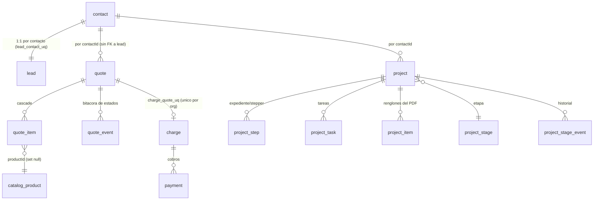

# Modelo de datos — LUMARK CRM

> Mapa del esquema **real** (PostgreSQL + Drizzle) al commit base `5ce91e2`.
> Fuente: `src/lib/db/schema.ts` (2 749 líneas) y las 68 migraciones en `drizzle/`.
> Convenciones: IDs de texto con prefijo (`src/lib/db/ids.ts`), dinero en **centavos enteros**
> (`src/lib/money.ts`), `organization_id` NOT NULL en toda tabla de dominio (multi-tenant, `lib/db/tenant.ts`).

## Núcleo comercial (P1)

Puntos duros confirmados:
- `quote` **no** referencia `lead` ni `project`; `project` **no** referencia `quote` ni `lead`
  (`schema.ts:1012-1063`, `1220-1263`). Solo se relacionan por `contactId`.
- `project_item` (`schema.ts:1164-1188`) usa `unit_price` en centavos, igual que `quote_item`
  (`schema.ts:1274-1299`) → destino natural del volcado cotización→proyecto.
- `charge.quoteId` es el único descendiente con FK real desde la cotización y tiene
  `uniqueIndex charge_quote_uq (organizationId, quoteId)` (`schema.ts:1356`).

## Tablas clave (referencia rápida)

| Tabla | Líneas | Notas |
|---|---|---|
| `catalog_product` | `schema.ts:1194-1218` | `price` (centavos), `stock` (null = sin control). **Sin `cost` ni `serviceType`** |
| `quote` | `schema.ts:1220-1263` | `status` varchar(20) default `draft`; `total`, `taxRate`, `version`, `lockedAt` |
| `quote_item` | `schema.ts:1274-1299` | `productId`, `unitPrice` (centavos) |
| `quote_event` | `schema.ts:1301-1321` | bitácora; soporte de idempotencia del agente |
| `project` | `schema.ts:1012-1063` | `code` (PRJ-XXXX), `projectType`, `status`, `stageId`, `estado` |
| `project_step` | `schema.ts:1066-1091` | stepper del expediente; unique `(projectId, stepKey)` |
| `project_task` | `schema.ts:1128-1157` | `estado` default `pendiente`; `google_event_id` |
| `project_item` | `schema.ts:1164-1188` | renglones del PDF; `unitPrice` centavos |
| `charge` / `payment` / `expense` | `schema.ts:1327-1413` | cobranza y caja; `expense.proveedor` es texto libre |
| `service_cost` | `schema.ts:1954-1979` | `catalogProductId` (FK opcional), `service`, `costCents`, vigencia |
| `campaign` | `schema.ts:1751-1777` | `platform`, `externalId`, `budgetPlannedCents` (planeado) |
| `campaign_insight` | `schema.ts:2331-2372` | insights diarios reales (Meta); `spendCents`, `conversionValueCents` |
| `attribution_event` | `schema.ts:1851-1906` | first/last touch, UTMs, `channelId`/`campaignId`/`offerId`/`creativeId` |
| `activity_event` | `schema.ts:1907-1951` | interacciones (llamada/correo/visita) |
| `experiment*` | `schema.ts:2006-2110` | A/B: hipótesis, variantes, observaciones con ingresos/costos/contribución |
| `sync_state` | `schema.ts:1982-2003` | estado por proveedor (sin uso hoy) |
| `marketplace_order` | `schema.ts:2140-2171` | `amountCents`, `commissionCents` |

## Entidades que FALTAN (a crear, justificadas)

- `project.quoteId` (o tabla puente `project_quote`) + unique idempotente — vínculo P1.
- `service_order` (folio `OS-XXXX`, estados propios, `projectId`+`quoteId`+`contactId`) — P1.
- `strategy` / `strategy_goal` / `strategy_channel_budget` / `strategy_activity` — módulo Estrategias.
- `catalog_product.cost` y/o `serviceType` — margen por producto (P4).

## Restricciones a modificar (con cuidado)

- `lead_contact_uq` (`schema.ts:259`): único por `contactId` → bloquea multi-oportunidad (P6).

## Estrategia de migración

Todas las migraciones del proyecto son **aditivas** y se aplican al arrancar el contenedor
(`Dockerfile:65` → `node migrate.mjs && node server.js`). Regla para este proyecto: nada de
`DROP`/reconstrucción de datos; los cambios de restricción se hacen con migración explícita y
verificación previa. Ver [`flujo-cotizacion-proyecto.md`](./flujo-cotizacion-proyecto.md) para el
detalle de la migración de P1.
